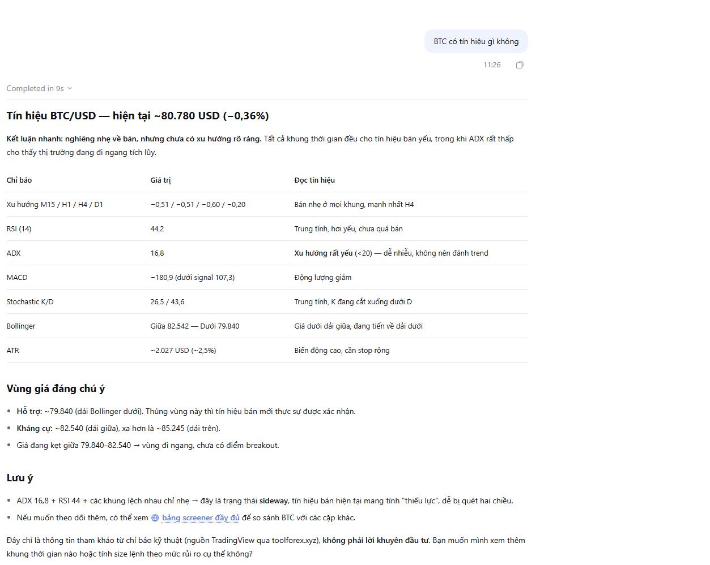

# MCP server

SocialForex exposes a public, read-only [Model Context Protocol](https://modelcontextprotocol.io) server so AI assistants (Claude, Cursor, VS Code, DeepSeek Harness, …) can pull live market data from the site.

- **Endpoint:** `https://toolforex.xyz/api/mcp`
- **Transport:** Streamable HTTP, stateless (JSON responses, no SSE stream, no session)
- **Auth:** none — only public data is exposed
- **Rate limit:** 60 requests / minute / IP



*Asked "BTC có tín hiệu gì không?" (any BTC signal?), the assistant calls `get_screener` and answers from live data: multi-timeframe ratings, RSI, ADX, MACD, Bollinger levels and ATR.*

## Tools

| Tool | What it returns |
|---|---|
| `get_quotes` | Bid/ask/mid and daily % change for forex, metals, oil, crypto. Optional `symbols` filter. |
| `get_economic_calendar` | Macro events (UTC) filtered by `currencies`, `minImpact` (default `medium`), `hoursAhead` (default 24, max 168), `hoursBack`. |
| `get_screener` | TradingView recommendation per M15/H1/H4/D1 plus RSI, ADX, MACD, Bollinger, stochastic, ATR. |
| `get_currency_strength` | Strength score of the 8 majors, strongest first. |
| `get_market_sessions` | Market open/closed, active sessions, current and next session overlaps. |
| `calculate_position_size` | Lot size for `balance`, `riskPct`, `entry`, `stopLoss` (USD account), optional margin for `leverage`. |

Every data tool returns a `link` to the matching page on the site.

## Connect

**Claude Code**

```bash
claude mcp add --transport http socialforex https://toolforex.xyz/api/mcp
```

**Claude Desktop / claude.ai** — Settings → Connectors → Add custom connector → paste the endpoint URL.

**Cursor** (`~/.cursor/mcp.json`) / **VS Code** (`.vscode/mcp.json`, key `servers`):

```json
{
  "mcpServers": {
    "socialforex": { "url": "https://toolforex.xyz/api/mcp" }
  }
}
```

**DeepSeek Harness** — save as `socialforex.cordis.yml` and pass it with `dsh web --patch socialforex.cordis.yml` (or merge the `insert` entry into `$DSH_HOME/cordis.patch.yml` to load it every run). Tools appear as `mcp__socialforex__<tool>`.

```yaml
- insert:
    - id: mcp-socialforex
      name: '@deepseek-ai/dsh-mcp-client'
      config:
        serverName: socialforex
        transport: streamable-http
        url: https://toolforex.xyz/api/mcp
```

Then ask, for example: *"What high-impact USD news is coming this week, and how strong is USD right now?"* or *"Lot size for XAUUSD, $5,000 account, 1% risk, entry 2650, SL 2640?"*

## Try it with curl

```bash
curl -s https://toolforex.xyz/api/mcp \
  -H 'Content-Type: application/json' \
  -d '{"jsonrpc":"2.0","id":1,"method":"tools/call","params":{"name":"get_quotes","arguments":{"symbols":["XAUUSD"]}}}'
```

## Code

- `src/app/api/mcp/route.ts` — HTTP handler (rate limit, CORS, batching, 202 for notifications)
- `src/lib/mcp/protocol.ts` — JSON-RPC / MCP core (`initialize`, `ping`, `tools/list`, `tools/call`)
- `src/lib/mcp/tools.ts` — tool definitions (Zod input schemas → JSON Schema)

To add a tool, append a `defineTool({...})` entry to `MCP_TOOLS`. Keep tools read-only and free of user data.

**Not yet supported:** personal tools (journal, MT5 positions) — these need a per-user API token and are tracked as a TODO.

> Educational information only, not investment advice.
